# ESPHome OpenThread网络拓展项目

此项目基于esphome为底板，依托esphome强大且方便集成的组件架构，拓展原有的BR功能，定位为OpenThread  Enhance

esphome在2026.11.0 dev版开始支持Thread Border Router组件，如只需基础BR功能，可以等待官方组件正式上线

乐鑫官方提供了ESP Thread Border Router/Zigbee Gateway的固件方案，你可以选择官方固件实现Thread BR功能

## 关于OpenThread

- OpenThread融合了 BLE 的低功耗、Zigbee 的 Mesh 自组网能力，以及 Wi-Fi 的 IP 网络互联优势
- 完整的Thread网络，由**边界路由**和**Thread节点**组成，Thread节点又有各自的分工，如图示意，分工由Thread内部自发协商
- 网络使用了IPV6，继承了很多IP网络的特性，通过多跳路由中继转发实现覆盖扩展，多BR多Router避免单点故障
- 用户端无需自建IPV6局域网，确保接入终端（HA/PC）开启IPV6即可

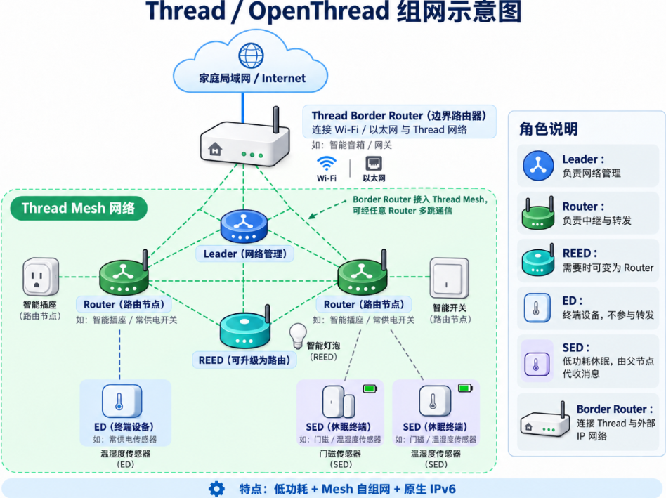

## 适配的边界路由

- 基于乐鑫官方[ESP Thread Border Router SDK](https://docs.espressif.com/projects/esp-thread-br/en/latest/)开发的硬件，比如：

  - 乐鑫ESP Thread Border Router/Zigbee Gateway 开发板（[ESP Thread Border Router/Zigbee Gateway cn｜乐鑫科技](https://www.espressif.com/zh-hans/dev-board/esp-thread-border-routerzigbee-gateway-cn)）  
    ​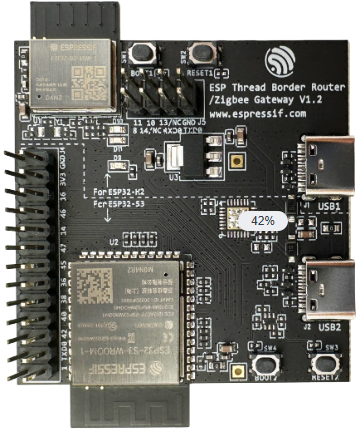
  - 本人基于乐鑫ESP Thread Border Router 原理图的复刻版（[乐鑫esp-thread-br边界路由复刻版 - 立创开源硬件平台](https://oshwhub.com/my-two-separate/project_gczciflo)）  
    ​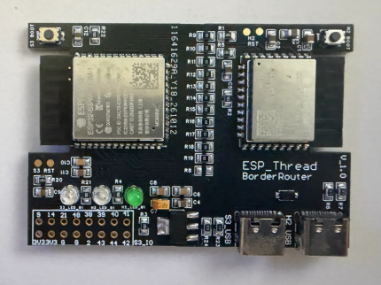
- 乐鑫官方Thread BR开发板尚未经过实际测试，组件的开发和测试基于本人的复刻版
- 复刻版与官方在主要硬件和IO上保持一致,组件在两者上的运行表现理论上一致（复刻板S3为8MB PSRAM，官方为2MB，存在未覆盖的内存测试）
- 组件开放HOST（ESP32-S3）与RCP（ESP32-H2）的互联IO配置，理论上，S3(HOST)可以使用其他硬件，比如ESP32，但是要求附带大于2MB的PSRAM

## 适配的节点MCU

- 支持IEEE 802.15.4射频的ESP32系列，C5/C6/H2/H21/H4/S31，使用ESP-IDF框架
- 未来可能支持nRF52840，使用Zephyr框架

## 适配的ESPHome版本

- 组件开发与测试基于2026.9.1，部分组件Fork自相同版本
- 其他版本需要自行验证，如esphome版本更新导致编译与运行问题，建议退回到示列版本2026.9.1

## 使用限制

- 组件不考虑适配Thread市场商品，只针对运行esphome的ESP32（未来可能支持nRF52840） openthread设备,且为固件预配置thread网络凭据，不支持运行时修改和配网流程
- 组件未经大规模部署验证，仅用于学习研究与家庭使用

## 目前实现的功能

|功能|状态|说明|
| :----------------------------------------------------: | :-----------------------------------: | :--------------------------------------------------------------------------------: |
|边界路由|✅|负责Thread内外部的通讯转换，原生功能|
|Thread网关|✅|负责管理Thread节点并代理HA实体，拓展功能|
|Thread节点-透传模式|✅|接入Thread网络并直接连接到HA，原生功能|
|Thread节点-网关模式|✅|接入Thread网络并通过Thread网关代理HA实体，拓展功能|
|Thread节点-P2P|✅|Thread节点间的应用层点对点通讯，拓展功能|
|Thread节点-访问LAN/WAN|✅|Thread节点可访问外部网络资源，原生功能|

## 项目目录

1. components/openthread

   - 在C6/H2 等 ESP32 原生 802.15.4 Thread 节点上运行，负责OpenThread通讯服务
   -  fork 自esphome 2026.9.1，修复PSKc、Network Key、Extended PAN ID配置内前导零的转换问题，添加DNS配置修改
2. components/openthread_info

   - 在C6/H2 等 ESP32 原生 802.15.4 Thread 节点上运行,提供一些thread网络的诊断实体
   - fork 自esphome 2026.9.1，修改将ip_address传感器取值转到实际对外的ipv6 OMR地址
   - 新增binary_sensor.thread_attach传感器，示意thread网络附着状态
   - 必须搭配本项目openthread组件使用，不要只使用此组件并搭配官方openthread
3. components/thread_br

   - 在适配的ESP Thread Border Router上运行，提供Thread边界路由服务
4. components/thread_gateway

   - 在适配的ESP Thread Border Router上运行，提供区别于边界路由的Thread 网关服务
   - 必须搭配本项目thread_br组件使用
5. components/thread_sed_transporter

   - 在C6/H2 等 ESP32 原生 802.15.4 Thread 节点上运行（未来可能支持nRF52840）
   - 提供传感器手动采样触发、RTC 变化基准和 Thread UDP 网关上报
   - 必须搭配本项目thread_gateway使用，节点端不使用esphome api
   - 适合周期性唤醒并统一上报的电池SED节点使用
6. components/thread_reed_transporter

   - 在C6/H2 等 ESP32 原生 802.15.4 Thread 节点上运行（未来可能支持nRF52840）
   - 有别于thread_sed_transporter，thread_reed_transporter由本地组件各自负责采样更新，没有统一触发机制
   - .必须搭配本项目thread_gateway使用，节点端不使用esphome api
   - 适合常在线REED节点的Thread UDP 网关上报
7. components\thread_p2p_transporter

   - 在C6/H2 等 ESP32 原生 802.15.4 Thread 节点上运行（未来可能支持nRF52840）
   - 提供Thread内部设备的点对点udp通讯，效果类似于espnow
   - 适合脱离HA脱离以太网的使用场景
8. components/thread_entity_bridge

   - thread_gateway、thread_sed_transporter、thread_reed_transporter的依赖组件
   - 用于内部共享实体适配层，实现实体属性传递
9. h2_rcp

   - 提供RCP(H2)的固件构建和烧录脚本
10. tool/ipv6_rio

    - 针对部分魔改linux内核系统缺失IPv6 Route Information Option（RIO，RA 选项 24）功能的情况，提供一个解决方案

11. tool/generate_thread_network.py

    - 提供一个脚本功能，随机生成一套合规的Thread网络凭据，可写入到BR的thread_network_config配置内

## 组件应用场景

1. Thread BR透传：ESPHome Thread 设备各自直接接入Homeassistant

   - esphome thread节点能够通过esphome 原生api接入HA，支持mDNS自动发现，支持远程OTA,支持节点Web服务，在体验上与wifi节点基本一致
   - 要求HA所在主机开启IPV6并支持ipv6_rio
   - 需要使用的组件：openthread、openthread_info（可选）、thread_br
   - 网络示意图（此处省略Thread角色分工）  
     ​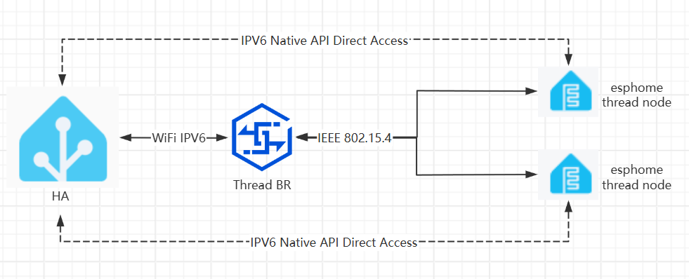

2. Thread Gateway代理：ESPHome Thread 设备接入Thread Gateway，只有一个Thread Gateway接入Homeassistant

   - esphome thread节点通过Thread udp协议与Thread Gateway通讯，Thread Gateway自动发现节点并按需创建实体到HA
   - HA所在主机无需IPV6,如有，可继承远程OTA和节点Web服务（非SED节点）
   - 需要使用的组件: openthread、openthread_info（可选）、thread_br、thread_gateway、thread_sed_transporter（电池节点使用）、thread_reed_transporter（常电节点使用）、thread_entity_bridge
   - 网络示意图（此处省略Thread角色分工）  
     ​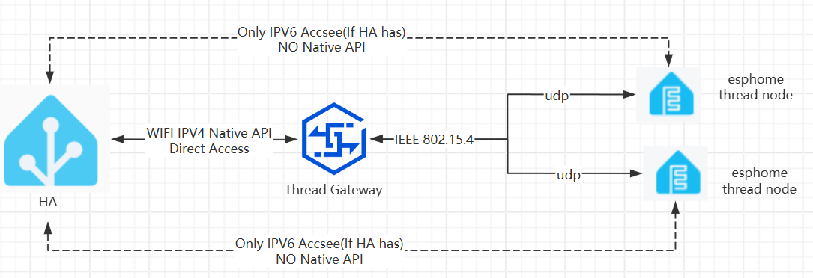
3. Thread P2P：Thread节点的点对点通讯

   - 在Thread网络内部进行udp单播消息收发，不依赖Thread BR、Thread Gateway或HA
   - 适合节点间的直接通讯，用于实现一些状态同步与片上自动化
   - 需要使用的组件: openthread、openthread_info（可选）、thread_p2p_transporter
   - 网络示意图（此处省略Thread角色分工）  
     ​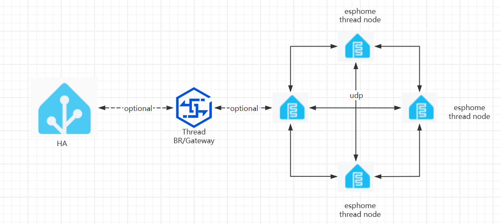

4. Thread BR透传、Thread Gateway代理和Thread P2P可以同时使用，建议用例为：

   - 电池SED节点使用Thread Gateway代理，常电REED节点使用BR透传
   - 如果HA所在主机或某些限制性环境无法实现IPV6和IPV6 RIO，可以统一使用Thread Gateway代理,HA仅需IPV4对接Thread Gateway。
   - 如果需要实现脱离HA脱离网络的实体状态同步和自动化，可以使用Thread P2P

## 项目使用示例

#### 上线Thread Border Router

- 购买或制作你的Thread Border Router，确保硬件功能正常

- 确保你已安装python3和合适的esphome pip版本，并清楚如何激活esphome python环境

1. 为ESP32-H2烧录RCP固件

   - cli进入h2_rcp目录，并激活esphome python环境（active）
   - 如需自定义IO,可编辑h2.yaml，如使用适配的硬件，则无需修改
   - 同时按住S3与H2的BOOT按键，并把PC USB连接到H2的USB接口，PC上会出现对应的COM端口
   - cli执行python脚本build_h2.py：​`python build_h2.py --flash --port COMX`​，注意，COMX换位实际的COM口编号，python别名可能无效，尝试​`python3 build_h2.py --flash --port COMX`
   - 脚本会自动编译并完成烧录，烧录完成断开USB即可

2. 完成ESP32-S3的基础esphome固件配置

   - 自行完成除了边界路由外的esphome基础yaml配置
   - 需要特别注意的配置：

     ```yaml
     psram:       #启用PSRAM
       mode: octal
       speed: 80MHz
       ignore_not_found: false

     api:
       reboot_timeout: 0s    #防止api超时而重启设备

     #不要配置蓝牙相关组件如esp32_improv、esp32_ble_tracker 

     wifi:
       reboot_timeout: 0s  ##防止wifi连接超时而重启设备
     ```
   - S3上的LED配置示列，wifi未连接是快闪，已连接为慢闪，通过"SYS LED"开关来控制

     ```yaml
     switch:
       - platform: template
         name: "SYS LED"
         id: indicator_led_sw
         optimistic: true
         restore_mode: RESTORE_DEFAULT_ON
         entity_category: "config"
         icon: "mdi:led-on"

     output:
       - platform: gpio
         pin: GPIO16
         id: indicator_led

     interval:
       - interval: 100ms
         then:
           - lambda: |-
               static uint32_t last = 0;
               uint32_t now = millis();

               bool wifi = wifi::global_wifi_component->is_connected();
               bool en = id(indicator_led_sw).state;

               bool should_be_on = false;

               if (!wifi) {
                 // 快闪：每 200ms 完整周期（100ms on + 100ms off）
                 should_be_on = ((now / 200) % 2) == 0;
               }
               else if (en) {
                 // 慢闪：周期 1800ms（1000ms 亮 + 800ms 灭）
                 uint32_t t = now % 1800;
                 should_be_on = (t < 1000);
               }
               // else → should_be_on 保持 false（常灭）

               id(indicator_led).set_state(should_be_on);
     ```
   - S3上控制H2的指示灯，注意thread_br_main为你的thread_br组件id

     ```yaml
     switch:
       - platform: template
         name: "RCP Activity LED"
         entity_category: config
         restore_mode: DISABLED  # 使能状态由 H2 的 NVS 保存；S3 仅跟随实际反馈
         optimistic: false
         lambda: return id(thread_br_main).get_rcp_activity_led_enabled();
         turn_on_action:
           - lambda: id(thread_br_main).set_rcp_activity_led_enabled(true);
         turn_off_action:
           - lambda: id(thread_br_main).set_rcp_activity_led_enabled(false);

       - platform: template
         name: "RCP Connection LED"
         entity_category: config
         restore_mode: DISABLED  # 使能状态由 H2 的 NVS 保存；S3 仅跟随实际反馈
         optimistic: false
         lambda: return id(thread_br_main).get_rcp_connection_led_enabled();
         turn_on_action:
           - lambda: id(thread_br_main).set_rcp_connection_led_enabled(true);
         turn_off_action:
           - lambda: id(thread_br_main).set_rcp_connection_led_enabled(false);
     ```

3. S3仅使用Thread BR透传的使用场景

   - 引入外部组件

     ```yaml
     external_components:
       - source:
           type: git
           url: https://github.com/gasment/esphome_enhance_thread
           ref: main
         components: [ thread_br ]
         refresh: 24h
     ```
   - 组件配置示列

     ```yaml
     network:
       enable_ipv6: true   #必须，开启ipv6

     thread_br:
       id: thread_br_main
       rcp:                 #rcp io配置不要修改
         uart_tx: GPIO18
         uart_rx: GPIO17
         rcp_reset_pin: GPIO7
         rcp_boot_pin: GPIO8
         coex_request_pin: GPIO12
         coex_priority_pin: GPIO10
         coex_grant_pin: GPIO13
         coex_tx_line_pin: GPIO11
         rcp_connectivity:  #rcp连接检测binary_sensor，可选
           id: rcp_connectivity
           name: RCP Connectivity
           #entity_category: "diagnostic"
       web: #web管理页配置
         port: 8080
         user: ${web_user}
         passwd: ${web_passwd}
       used_psram: true  #使用PSRAM来增强系统性能，需要先配置好PSRAM组件
       thread_network_config:  #Thread网络凭据，同一thread网络内的所有设备都必须一致
         channel: 20    #推荐信道20，错开2.4Gwifi频段
         network_name: "MY Thread Net"
         network_key: 0x7d990160a1e11a8fd49e2e2798a88bd9
         pan_id: 0x0eff
         ext_pan_id: 0x591cbc42f1a3afe5
         pskc: 0x083a4a1f077cb39a310527cb92ab0948
         mesh_local_prefix: fdd1:dd68:9fa3:d942::/64
         force_dataset: true

       #以下为一些可选的诊断传感器
       thread_attached:
         name: Thread Attached
       thread_role:
         name: Thread Role
       rcp_version:
         name: RCP Version
       neighbor_count:
         name: Thread Neighbors
       child_count:
         name: Thread Direct Children
     ```
   - thread_network_config如果不清楚如何修改，可以使用tools内的generate_thread_network.py脚本随机生成，如

     ```yaml
     D:\tools>python generate_thread_network.py
     Saved: D:\tools\output\thread_network_config-20261019-154611-8099b9.yaml
     # Paste this block under thread_br; use the SAME values on all nodes.
     # Keep this file private: network_key and pskc are network credentials.
     thread_network_config:
       channel: 20
       network_name: "DIY-9024a663"
       network_key: 0x7e17300771c0bf8805e83a08e690c564
       pan_id: 0x53e1
       ext_pan_id: 0x547fe4ace1c7213c
       pskc: 0x9289b2a3378fbd3133ffb234a40864cd
       mesh_local_prefix: fded:1878:679a:7c91::/64
       force_dataset: true
     ```
   - 编辑完成后，按住S3 BOOT按键，接入PC USB到S3 USB，运行esphome编译和烧录​`esphome run your_yaml_file.yaml`
   - 设备重新上电启动，如使用复刻版硬件，LED正常状态蓝灯1慢闪代表wifi已连接，蓝灯2常亮代表RCP已连接，绿灯不规律闪烁代表RCP通讯活动
   - 进入HA集成界面，会自动发现设备，添加即可  
     ​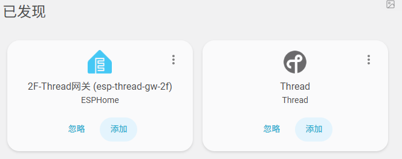
   - 进入边界路由的ip+web端口，可输入设定的用户和密码进入web管理页面，管理页面使用乐鑫固件方案，仅作简中翻译  
     ​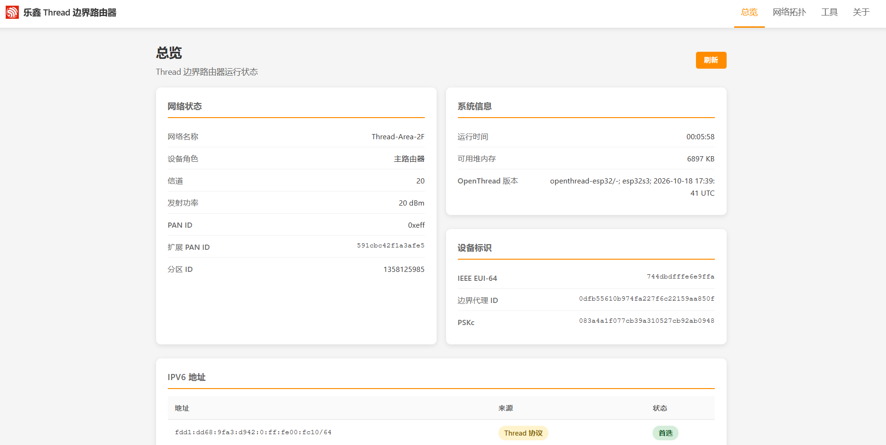

4. S3需要使用Thread Gateway代理的使用场景

   - 按第3点配置好thread_br组件
   - 加入thread\_gateway和依赖组件

     ```yaml
     external_components:
       - source:
           type: git
           url: https://github.com/gasment/esphome_enhance_thread
           ref: main
         components: [ thread_br, thread_gateway, thread_entity_bridge ]
         refresh: 24h
     ```
   - thread_gateway组件配置示例

     ```yaml
     thread_gateway:
       id: thread_gateway_main
       thread_br_id: thread_br_main   #上面的thread_br组件id
       reed_heartbeat_misses: 3   # 仅 REED 按心跳缺失次数判定离线，SED 不判定离线。

       gateway_id: "thread-br-gw"  
       #唯一的网关身份,仅允许 1～32 位英文字母、数字、下划线或短横线；
       #更名相当于更换接收网关身份,必须前期明确，后期修改将会导致所有代理节点离线

       entity_auto_register: false
       # entity_auto_register：true #自动批准新发现实体，保存清单，下次重启生效；不会自动重启网关。
       # entity_auto_register：false #新实体进入待确认列表，由用户在“网关管理”页面勾选批准

       discovery:  #用于网关自动发现节点
         multicast_address: "ff13::8000:8562"
         # IPv6 realm-local 多播地址；所有节点和接收网关必须使用相同的发现组地址。
         # 只允许修改最后一组数字,使用1～4位十六进制数字，如1234，abcd

         port: 18512
         # UDP 发现端口，整数 1～65535；节点与网关保持一致。
         # 不要与下方udp业务端口相同

         address_ttl: 30min
         # 节点缓存本接收目标的有效期，1s～24h，如 60s、30min、1h。

         announce_interval: 60s
         # 网关周期宣告间隔，1s～24h，如 30s、60s、5min。

       udp:
         port: 18513     # UDP 业务端口，整数 1～65535；

       # 已批准实体按节点自动归属 HA 子设备，设备名采用节点 name。
       # 无需逐个声明 esphome.devices；子设备槽位自动预留 min(128, 下方三类总和)。
       capacity:
         # 编译期预留实体数量，非负整数；0 表示不预留该类型。
         # 每类 0～1024，总和 1～2048；这是配置上限，实际容量还受 RAM/NVS 空间限制。
         sensors: 30
         binary_sensors: 30
         text_sensors: 30
         switches: 30
         numbers: 30
         selects: 30
         buttons: 30
         texts: 30
         lights: 30
         fans: 30
         covers: 30
         climates: 30
         locks: 30
         valves: 30
         nvs: 256KB  #实体清单写入 NVS 的大小上限，不是分区大小或预留空间。


       # 可选上报回调：将节点上报值路由到网关本地模板实体；不要求来源获准接入 HA。
       # node_id / entity_id 精确匹配，entity_id 使用节点 thread_sed/reed_transporter输出id。
       # type: sensor / binary_sensor / text_sensor；x 分别为 float / bool / std::string。
       on_node_update:
         - node_id: my_sed_node
           entity_id: illumination_on_node
           type: sensor
           then:
             - sensor.template.publish:
                 id: local_illumination
                 state: !lambda return x;
     sensor:
       - platform: template
         id: local_illumination
         name: "Local Illumination"
         unit_of_measurement: "lx"
         device_class: illuminance
         state_class: measurement
         accuracy_decimals: 0

     ```
   - 添加thread_gateway组件后，边界路由的web管理页右上角会新增一个网关管理页
   - 通过thread_sed/reed_transporter组件接入的设备会被自动添加到这个页面

     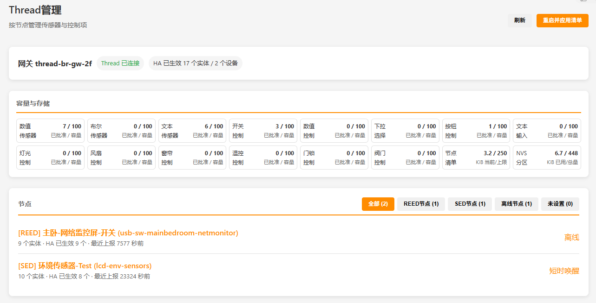
   - 点击具体设备，会进入实体管理页面，在这里，你可以设置哪些实体需要暴露到HA，REED节点额外支持web控制实体。

     实体选择完成后，点击“接入保存选择”后，再点击“重启并应用清单”，网关再重启后，勾选的实体会以子设备形式挂在网关设备下

     注意每次修改勾选清单，都需要重启设备来生效。

     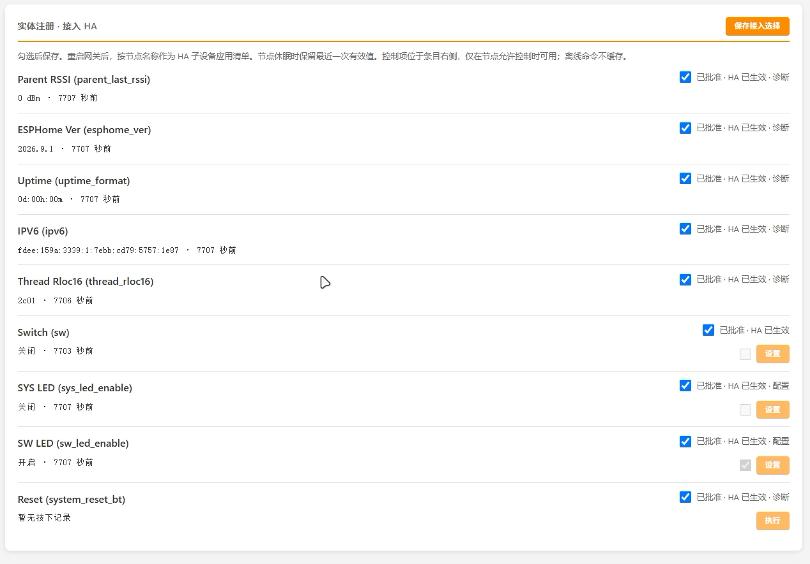

#### 检查你的HA服务器IPV6能力

- 制作节点前，需要确定，你的HA环境支不支持IPV6 RIO（IPV6 路由自动学习）

  - 对于HAOS，我猜测极大概率支持，基金是HA官方系统，且官方支持Thread网络，那IPV6基础协议应该是完善的，我不用HAOS，不好断言
  - 对于虚拟机套HAOS，优先考虑使用直通或者透明网桥，虚拟网卡需要自行确定ipv6能力
  - 对于Docker容器，则优先使用host网络模式，并且确保宿主机IPV6能力
- 如何测试IPV6 RIO能力

  1. 进入HA所在宿主系统ssh，查看ipv6的RA路由表

     ```yaml
     ip -6 route show proto ra
     ```
  2. 返回信息可能如下

     ```yaml
     [root@opi5plus ~]# ip -6 route show proto ra
     fd59:1cbc:42f1:afe5::/64 dev enP2p33s0 metric 100 pref medium
     fdf2:a6af:ee71:1::/64 via fe80::a6cb:8fff:fee2:a980 dev enP2p33s0 metric 100 pref medium
     ```
  3. 如果设备有RIO学习机制，那么它就会返回关于我们Thread BR的通告路由“fdf2:a6af:ee71:1::/64 via fe80::a6cb:8fff:fee2:a980”，如果没有RIO，执行命令并不会返回任何信息

     如果存在RA路由表，可以进入Thread BR的web后台，在网络拓扑里，点击主路由节点，它有好几个IPV6,如图，其中就有相同fdf2:a6af:ee71:1前缀的一项，在ssh内ping它，如果能顺利ping通，证明你HA的IPV6链路正常,那么你可以使用Thread BR透传模式

     ```yaml
     [root@opi5plus ~]# ping fdf2:a6af:ee71:1:7b2b:bf4e:9ce8:d386
     PING fdf2:a6af:ee71:1:7b2b:bf4e:9ce8:d386 (fdf2:a6af:ee71:1:7b2b:bf4e:9ce8:d386) 56 字节的数据
     64 字节，来自 fdf2:a6af:ee71:1:7b2b:bf4e:9ce8:d386: icmp_seq=1 ttl=255 时间=5.62 毫秒
     64 字节，来自 fdf2:a6af:ee71:1:7b2b:bf4e:9ce8:d386: icmp_seq=2 ttl=255 时间=4.04 毫秒
     64 字节，来自 fdf2:a6af:ee71:1:7b2b:bf4e:9ce8:d386: icmp_seq=3 ttl=255 时间=5.23 毫秒
     64 字节，来自 fdf2:a6af:ee71:1:7b2b:bf4e:9ce8:d386: icmp_seq=4 ttl=255 时间=26.9 毫秒

     ```

     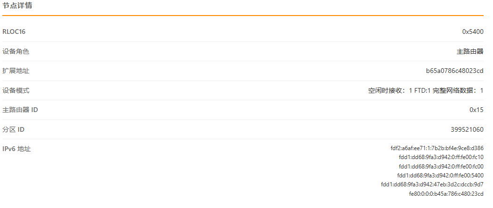

     ‍
  4. 如果没有有效的RA路由表，先确认你是否开启了设备网卡的IPV6协议，再看存不存在已有路由表

     - 使用​`ip a | grep "192.168.x.x"`来检查当前HA IP所在的网卡名，输出的最后一个字段就是，比如ovs_eth2

       ```yaml
       root@DSM-Server:~# ip a | grep "192.168.32.32"
           inet 192.168.32.32/24 brd 192.168.32.255 scope global ovs_eth2
       ```
     - 使用​`ip a show dev xxxxx`来检查网卡是否具备ipv6地址，xxxxx换为上一步取得的网卡名，执行后输出内，有inet6相关信息，代表ipv6协议正常

       ```yaml
       root@DSM-Server:~# ip a show dev ovs_eth2
       12: ovs_eth2: <BROADCAST,MULTICAST,UP,LOWER_UP> mtu 1500 qdisc noqueue state UP group default qlen 1000
           link/ether 00:02:c9:9f:d0:a0 brd ff:ff:ff:ff:ff:ff
           inet 192.168.32.32/24 brd 192.168.32.255 scope global ovs_eth2
              valid_lft forever preferred_lft forever
           inet6 fd59:1cbc:42f1:afe5:202:c9ff:fe9f:d0a0/64 scope global dynamic mngtmpaddr
              valid_lft 1794sec preferred_lft 1794sec
           inet6 fe80::202:c9ff:fe9f:d0a0/64 scope link
              valid_lft forever preferred_lft forever
       ```
  5. 如果ipv6已开启，但是没有RIO学习机制，那么可以尝试使用本项目提供的RA学习脚本tool/ipv6_rio，要求具备python3环境和root权限

     - 将脚本放到你目标主机的任意存储位置比如root目录，赋于执行权限：​`chmod +x /root/learn_routes.py`
     - 尝试脚本能不能监听到局域网RA通告，执行脚本：​`python3 /root/learn_routes.py --interface ovs_eth2`​,​`ovs_eth2`换为你的网卡名
     - 如果脚本输出内有显示如下类似的路由信息，即为成功,按CTRL+C终止脚本

       ```yaml
       root@DSM-Server:~# chmod +x learn_routes.py
       root@DSM-Server:~# ^C
       root@DSM-Server:~# python3 /root/learn_routes.py --interface ovs_eth2
       2026-10-19 19:41:12,908 INFO OBSERVE (no route changes) on ovs_eth2; ULA /64 RIOs; routers=any link-local RA source
       2026-10-19 19:41:15,442 INFO RA fe80::a6cb:8fff:fee2:a980: fdf2:a6af:ee71:1::/64 preference=0 lifetime=1800
       2026-10-19 19:41:23,665 INFO RA fe80::a6cb:8fff:fee2:a980: fdf2:a6af:ee71:1::/64 preference=0 lifetime=1800
       2026-10-19 19:41:29,094 INFO RA fe80::a6cb:8fff:fee2:a980: fdf2:a6af:ee71:1::/64 preference=0 lifetime=1800
       ```
     - 当前只是检测，需要应用RA路由，需要执行​`python3 /root/learn_routes.py --interface ovs_eth2 --apply`​，​`ovs_eth2`换为你的网卡名，然后你再去ping Thread BR内相同前缀的IPV6（fdf2:a6af:ee71:1），如果ping通，说明脚本对你有效
     - 脚本退出就不会继续学习的，需要设置为开机启动和后台服务，至于怎么设置，每个系统都不一样，这里展示下systemd方式，其他方式自行实践

       1. 新建一个systemd文件：​`touch /etc/systemd/system/ipv6_rio.service`
       2. 使用文本编辑工具打开​`/etc/systemd/system/ipv6_rio.service`文件，添加文件内容并保存：  
          注意：

          - ExecStart内，/bin/python3需要python3的绝对路径，可以使用 ​`which python3`命令取得
          - ExecStart内/root/learn_routes.py文件路径按你实际修改，ovs_eth2网卡名也按实际修改

          ```yaml
          [Unit]
          Description=Thread IPv6 RA Route Learner
          Wants=network-online.target
          After=network-online.target
          StartLimitIntervalSec=0

          [Service]
          Type=simple
          User=root
          ExecStart=/bin/python3 -u /root/learn_routes.py --interface ovs_eth2 --apply
          Restart=always
          RestartSec=10
          TimeoutStopSec=15

          [Install]
          WantedBy=multi-user.targetr
          ```
       3. 赋予文件执行权限：​`chmod 755 /etc/systemd/system/ipv6_rio.service`
       4. 重载systemd服务文件：​`systemctl daemon-reload`
       5. 启动脚本服务：​`systemctl start ipv6_rio.service`
       6. 查看脚本服务运行情况：​`systemctl status ipv6_rio.service`，如正常运行，输出类似如下：

          ```yaml
          root@DSM-Server:~# systemctl status ipv6_ra.service
          ● ipv6_ra.service - Thread IPv6 RA Route Learner
             Loaded: loaded (/etc/systemd/system/ipv6_ra.service; enabled; vendor preset: disabled)
             Active: active (running) since Fri 2026-10-16 00:22:59 CST; 3 days ago
           Main PID: 3845 (python3)
             CGroup: /system.slice/ipv6_ra.service
                     └─3845 /bin/python3 -u /volume1/docker/homeaasistant_2026/ipv6_ra_sevice/learn_routes.py --interface ovs_eth2 --apply

          Oct 19 19:57:07 DSM-Server python3[3845]: 2026-10-19 19:57:07,139 INFO RA fe80::a6cb:8fff:fee2:a980: fdf2:a6af:ee71:1::/64 preferenc...ime=1800
          Oct 19 19:57:07 DSM-Server python3[3845]: 2026-10-19 19:57:07,140 INFO Learned fdf2:a6af:ee71:1::/64 via fe80::a6cb:8fff:fee2:a980 l...ric=3072
          Oct 19 19:57:18 DSM-Server python3[3845]: 2026-10-19 19:57:18,266 INFO RA fe80::a6cb:8fff:fee2:a980: fdf2:a6af:ee71:1::/64 preferenc...ime=1800
          Oct 19 19:57:18 DSM-Server python3[3845]: 2026-10-19 19:57:18,267 INFO Learned fdf2:a6af:ee71:1::/64 via fe80::a6cb:8fff:fee2:a980 l...ric=3072
          ```
       7. 配置脚本服务开机启动：​`systemctl enable ipv6_rio.service`
- 根据检查和修复结果，你可以选择的接入方式：

  1. HA具备IPV6 RIO能力，推荐使用Thread BR透传模式
  2. HA不具备IPV6 RIO能力，但是通过脚本实现了，推荐使用Thread BR透传模式
  3. HA不具备IPV6 RIO能力，且无法修复，选择使用Thread Gateway模式
- 不同接入方式主要的差异：

  1. Thread BR透传模式，HA实体由各自ESPhome Thread设备提供，边界路由离线会导致所有Thread设备也会离线（对于HA而言），但是你可以配置多个相同Thread网络凭据的边界路由，避免单点故障，一台边界路由崩了，Thread设备会自动选择另一台正常的边界路由通讯，过程无感，不需要人为干预，这也是Thread 多跳路由网络的优势
  2. Thread Gateway模式，HA实体全都集中在边界路由上，边界路由离线会导致所有Thread设备也会离线（对于HA而言），而且不能像透传模式那样配置多个边界路由来避免，因为Gateway模式下，Thread设备与Gateway是一对一绑定的，不能路由到其他Gateway。而且，实体需要Gateway代理到HA，边界路由的系统压力与实体数量为正相关
  3. 不过注意，这里说的Thread设备离线而相对于HA来说的，Thread网络内部依旧正常，可以继续P2P通讯。

#### 上线你的第一个Thread BR透传节点

- Thread BR透传节点，只需要修改现有esphome配置的网络部分，其他诸如传感器等配置可以直接沿用
- 删除wifi相关的所有配置，包括​`captive_portal`
- 添加openthread组件：

  1. 引入组件

     ```yaml
     external_components:
       - source:
           type: git
           url: https://github.com/gasment/esphome_enhance_thread
           ref: main
         components: [ openthread, openthread_info ]
         refresh: 24h
     ```
  2. openthread配置

     ```yaml
     network:
       enable_ipv6: true  #必须，启用ipv6

     openthread:
       id: openthread_main
       device_type: FTD    #必须，配置为FTD设备
       channel: 20      #channel和以下thread网络凭据配置，必须与边界路由上的Thread_br组件配置一致
       network_name: "Thread-Area-2F"
       network_key: 0x7d990160a1e11a8fd49e2e2798a88bd9
       pan_id: 0x0eff
       ext_pan_id: 0x591cbc42f1a3afe5
       pskc: 0x083a4a1f077cb39a310527cb92ab0948
       mesh_local_prefix: fdd1:dd68:9fa3:d942::/64
       force_dataset: true
       output_power: 10dBm  #可选，默认为0dBm。可以适当提高射频发射功率，ESP32-C5/C6 from -15dBm to 20dBm, ESP32-H2 from -24dBm to 20dBm
       ipv4_dns: "223.5.5.5"  #可选，默认为8.8.8.8。thread节点访问域名资源时需要使用的DNS服务器，仅支持ip格式


     #以下为一些FTD设备比较有使用价值的诊断传感器（可选）
     text_sensor:
       - platform: openthread_info
         ip_address:   #设备的对外ipv6地址，可以使用此地址，直接连接到此设备进行远程ota和远程api
           id: ipv6
           name: "IPV6"
           entity_category: "diagnostic"
           icon: "mdi:ip"      
         rloc16:   #设备在thread网络拓扑中的身份标识，不固定，可用于在web管理页定位设备在拓扑中的角色
           id: thread_rloc16
           icon: "mdi:identifier"
           entity_category: diagnostic
           name: "Thread Rloc16"
         best_router_link_quality:  #设备为路由节点时，最佳邻居的信号质量
           id: best_router_link_quality
           name: "Router Link Quality"
           update_interval: 10s

     binary_sensor:
       - platform: openthread_info  
         thread_attach:   #设备的thread网络连接状态，通常配合一些led来反馈工作状态
           id: thread_attach
     ```
- 使用​`esphome run your_yaml_file.yaml`来编译并刷入固件到设备
- 设备启动后，进入HA 集成页面，如无意外，直接自动发现设备，按常规wifi esphome节点接入即可  
  ​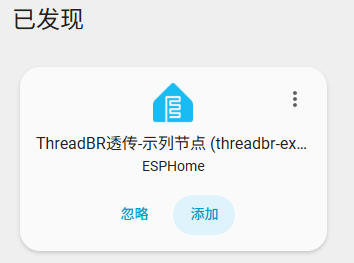
- 在边界路由的web页面，网络拓扑中可以看到，这个设备也成为了一个路由器  
  ​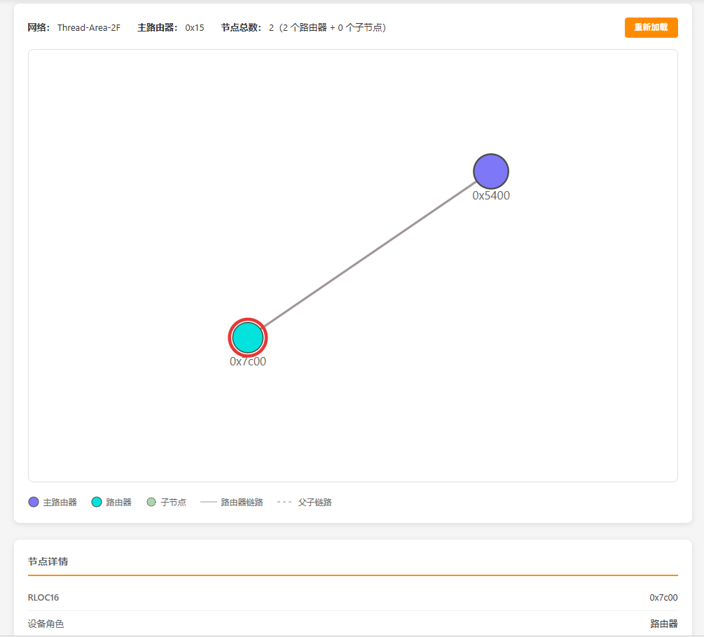

- 设备HA传感器提供了一个IPV6，开启windows网卡的ipv6功能，就可以直接使用该地址对设备进行OTA和api日志访问

  `esphome logs my_yaml.yaml  --device fdf2:a6af:ee71:1:23f3:da52:7618:31ab `

  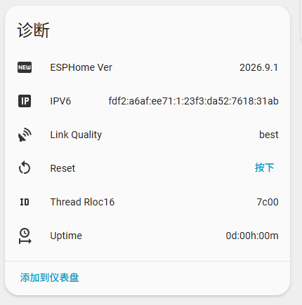
- 排障：如果没有发现设备，进入边界路由的Web管理页，右上角进入工具，检查SPR服务注册中，是否出现了你设备的相关条目

  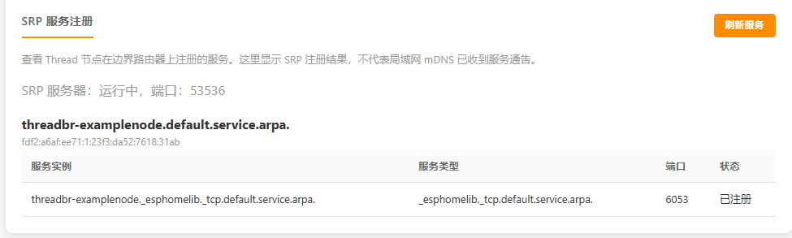

  如果没有，尝试使用设备的ipv6地址连接，但该地址并不固定，仅建议用于测试  
  ipv6对外地址一般是第二个  
  ​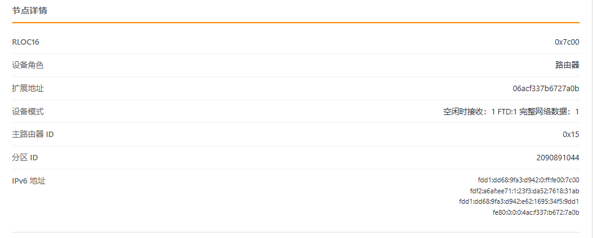

‍

#### 上线你的第一个Thread Gateway代理节点

- Thread Gateway代理节点又分为REED常电节点，和SED休眠节点

##### 接入REED常电节点：

1. 与Thread BR透传节点一样，修改现有esphome配置的网络部分，其他诸如传感器等配置可以沿用

   - 删除wifi相关所有配置
   - 删除api配置

2. 添加openthread组件，参考Thread BR透传节点的openthread配置即可
3. 添加thread\_reed\_transporter组件

   1. 引入组件

      ```yaml
      external_components:
        - source:
            type: git
            url: https://github.com/gasment/esphome_enhance_thread
            ref: main
          components: [ thread_reed_transporter, thread_entity_bridge ]
          refresh: 24h
      ```
   2. 组件配置示列  

      ```yaml
      thread_reed_transporter:
        id: node_transporter
        openthread_id: openthread_main
        node_id: ${project_name}        # 1..32 位 ASCII 字母、数字、下划线或连字符；保持稳定
        name: ${friendly_name}          # 支持中文
        manifest_revision: 1            # 增删实体或修改名称、单位、能力后递增；数值变化不用改，建议任意配置修改后+1
        gateway_id: thread-br-gw-2f     # 可选：指定网关；省略则接受发现的首个有效网关，建议指定，名称必须与thread_gateway中的gateway_id一致
        heartbeat_interval: 10s         # 1s..15s，维持 30s 控制租约，并核对清单版本
        batch_delay: 200ms              # 合并短时间内的状态变化，最大 10s
        full_sync_interval: 60s         # 最小 1s，周期校正状态；重连也会全量同步
        discovery:                      #必须与边界路由thread_gateway内配置一致，否则无法自动发现节点
          multicast_address: "ff13::8000:1234"
          port: 12138
        ack:
          timeout: 500ms                  # 每轮 ACK 等待 100ms..60s
          resend: 2                    # 0..10 次，重发同一轮报文，不重新执行控制
        switches:                     #直接引用现有组件id，按组件类型区分，下同
          - indicator_led_sw
        buttons:
          - system_reset_bt
        text_sensors:
          - esphome_ver
          - uptime_format
          - ipv6
          - thread_rloc16
          - best_router_link_quality
        sensors:
          - illumination_bh1750
          - sht30_temperature
          - sht30_humidity


        # 以下列表同样仅填写现有实体 id；启用前先定义对应本地组件。：
        # sensors: [temperature, humidity]
        # binary_sensors: [door_contact]
        # numbers: [target_value]
        # selects: [operating_mode]
        # texts: [custom_label]
        # lights: [living_light]
        # fans: [ventilation]
        # covers: [curtain]
        # climates: [air_conditioner]
        # locks: [door_lock]
        # valves: [water_valve]

      ```
4. 使用​`esphome run your_yaml_file.yaml`来编译并刷入固件到设备

   ‍

   ‍
5. 刷写完成后，等待设备启动，然后进入边界路由的Web管理页，切换到网关管理界面，如无意外，会显示我们刚刚刷写的设备，网络拓扑界面也会显示新设备的组网状态

   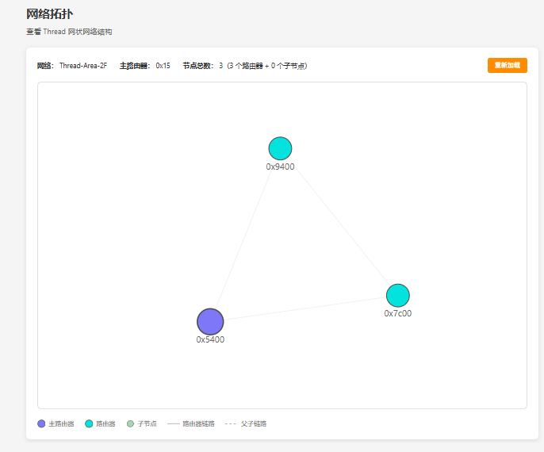

   
6. 点击设备，进入实体管理界面，在这里，你可以批准哪些实体接入HA，以及对一些控制实体进行操作  
   ​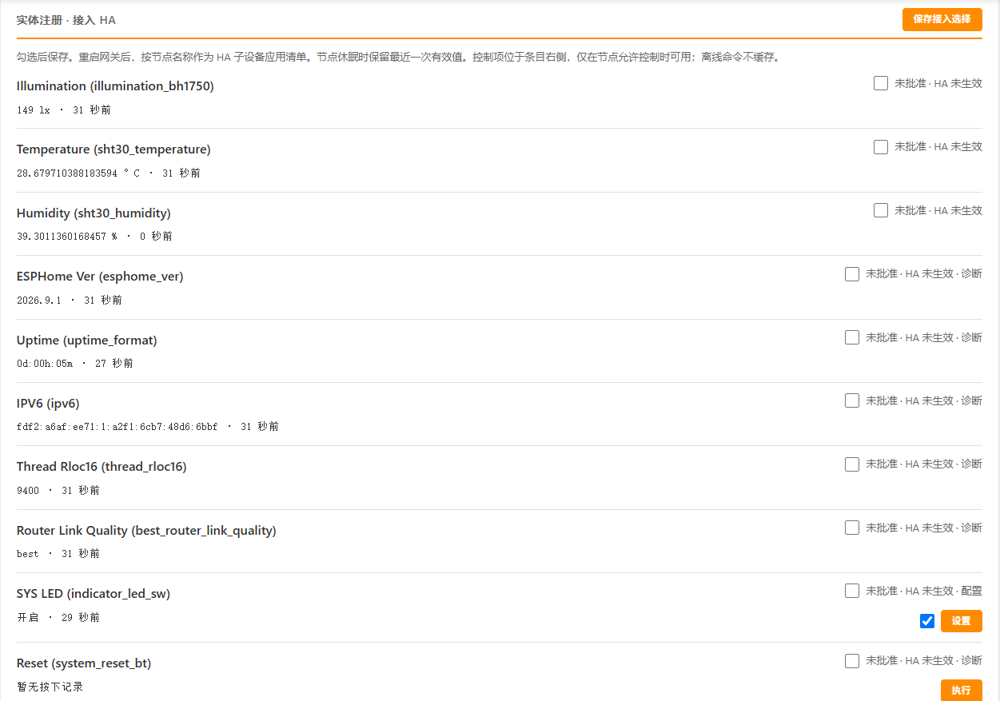
7. 勾选完保存，然后重启设备以应用设置，转到HA esphome集成下，边界路由的设备页面，会多出来一个子设备  
   ​  
   其中就是我们刚那勾选批准的实体，你可以增加或减少批准的实体，每次修改，都必须保存并重启以生效  
   ​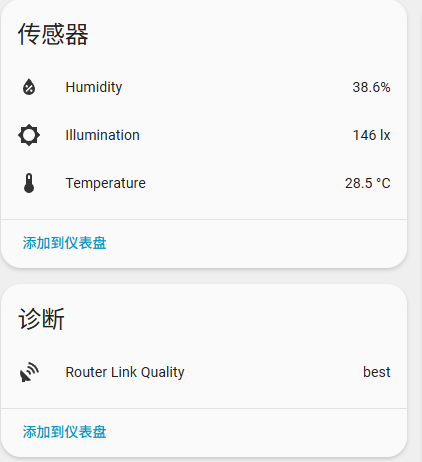

8. 接入Gateway代理的REED常电节点也可以使用IPV6进行OTA，但是无法远程调试日志，因为没有配置api组件

##### 接入SED电池节点

1. 与REED常电节点一样，修改现有esphome配置的网络部分，其他诸如传感器等配置可以沿用

   - 删除wifi相关所有配置
   - 删除api配置

2. 添加openthread组件，参考REED常电节点的openthread配置即可，但是其中的​`device_type`​需要射为​`MTD`​，并且添加​`poll_period: 0s`
3. 添加thread\_sed\_transporter组件

   1. 引入组件

      ```yaml
      external_components:
        - source:
            type: git
            url: https://github.com/gasment/esphome_enhance_thread
            ref: main
          components: [ thread_sed_transporter, thread_entity_bridge ]
          refresh: 24h
      ```
   2. 组件配置示列

      ```yaml
      thread_sed_transporter:
        id: sensor_reporter
        openthread_id: openthread_main  # 绑定openthread组件ID
        node_id: ${project_name}        # 1..32 位 ASCII 字母、数字、下划线或连字符；保持稳定
        name: ${friendly_name}		  # 支持中文
        manifest_revision: 1            # 建议修改任意配置后+1
        discovery:
          gateway_id: thread-br-gw-2f   # 建议指定，名称必须与thread_gateway中的gateway_id一致
          multicast_address: "ff13::8000:1234"  #必须与thread_gateway中的配置一致
          port: 12138                           #同上
          timeout: 1s
        full_report_every: 20           #多少次上报后执行全量上报

        control_ready: !lambda |-         
          return id(usb_detect).state || id(key_wakeup_event);
        #用于thread_gateway判断此节点是否可控制，一般搭配按键或充电状态，让设备进入非休眠模式，以接收来自gateway的控制
        #使用lambda来动态赋值true/false

        heartbeat_interval: 10s   #心跳间隔，thread_gateway判断休眠状态的依据
        acquisition_delay: 0s  # 组件采集延迟，防止某些传感器在系统启动时未就绪或未稳定，比如ADC
        timeout: 5s             #单次上报的总时间预算，防止默写传感器采集卡住而持续运行

        # id 直接引用本地实体；名称、单位、分类、filters 和自动化只在源端定义。
        # 数值传感器自身为 PollingComponent 时自动更新；共享父组件需指定。
        # 二进制/文本默认读取现有状态；只有显式配置 source_components 才等待新发布。
        sensors:
          - id: illumination_bh1750
            delta: 2    #满足变化阈值才发送，下同
          - id: sht30_temperature
            source_components: sht30_main  #部分传感器存在父组件时，需要指定父组件ID,下同
            delta: 0.2
          - id: sht30_humidity
            source_components: sht30_main
            delta: 1
          - id: battery_soc
            source_components: cw2017_main
            delta: 1
          - id: battery_voltage
            source_components: cw2017_main
            delta: 0.05
          - id: parent_last_rssi
            delta: 2
        text_sensors:
          - id: esphome_ver
          - id: thread_rloc16
        binary_sensors:
          - id: usb_detect
        switches:
          - sys_led_enable


        # 仅配置了 ack 的 report 才触发以下两个回调之一；report_id 标识本次调用。
        on_report_success:
          then:
            - lambda: |-
                ESP_LOGI("sensor_reporter", "Report %u communication succeeded",
                         static_cast<unsigned>(report_id));
        on_report_fail:
          then:
            - lambda: |-
                ESP_LOGW("sensor_reporter", "Report %u communication failed after ACK attempts",
                         static_cast<unsigned>(report_id));

      # 仅代表本地处理已完成，不代表gateway已收到
         on_complete:
           then:
             - lambda: |-
                 ESP_LOGI("sensor_reporter", "UDP local processing: success=%s sent=%u unchanged=%u invalid=%u errors=%u",
                          YESNO(success), static_cast<unsigned>(sent), static_cast<unsigned>(unchanged),
                          static_cast<unsigned>(invalid), static_cast<unsigned>(errors));
      ```
   3. 统一上报传感器信息到gateway

      ```yaml
      on_xxxxxx:
        then:
           - thread_sed_transporter.report:
                id: sensor_reporter  #thread_sed_transporter的组件id
                ack:  # 可选；删除整个 ack 块即关闭确认，结果回调也不触发。
                  timeout: 500ms  # 每次等待 ACK：1ms~60s；省略此项默认 2s。
                  resend: 1  # 首发之外最多重发 0~10 次；默认 0；此处最多发送 2 次。

      #配置ack的report,接收到gateway的回复确认，会触发on_report_success回调，如果超时则触发on_report_fail
      ```
   4. 本地源传感器，建议配置​`update_interval: never`,让thread_sed_transporter组件统一更新采集，如某些传感器不更新，可以配置一个短的update_interval如1s
4. SED节点的实体接入HA与REED节点一致，区别是，SED节点的控制类实体不允许接入HA，web控制也仅限可控模式
5. SED节点不会成为Thread网络内的Router
6. 接入Gateway代理的SED电池节点也可以使用IPV6进行OTA，但是需要先进入可控状态，无法远程调试日志，因为没有配置api组件

‍

‍

#### 进行Thread设备间的通讯，不经过Thread BR或Gateway

- `thread_p2p_transporter`组件通过指定接收端的ipv6地址和定制udp报文，来实现单播P2P通讯。

  - thread设备无需接入HA，也无需接入Gateway，甚至无需Thread BR
  - P2P设备无需面对面连接，依赖thread的多跳和网状路由，可以在Thread网络覆盖范围内，任意两节点通讯
  - SED接点仅允许发送，REED节点允许发送和接收
- 本例展示SED thread设备上的一个按钮，直接控制REED thread设备上的一个开关（如无线开关遥控智能开关）、

  1. SED发送端配置（需首先配置好openthread组件，并将deivce_type设为MTD）

     ```yaml
     external_components:
       - source:
           type: git
           url: https://github.com/gasment/esphome_enhance_thread
           ref: main
         components: [ thread_p2p_transporter ]
         refresh: 24h

     thread_p2p_transporter:
       send_to_addr_list:
         - id: wall_switch   #接收端代号，仅用于匹配，与接收端配置无关
           address: "fd7a:115c:a1e0:1::1001"    
           #接收端ipv6,必须在接收端提前定义，且必须与thread_br组件的mesh_local_prefix前缀一致
           #比如你的前缀是fdd1:dd68:9fa3:d942::/64，那么这里可以设置为fdd1:dd68:9fa3:d942::1001，fdd1:dd68:9fa3:d942::1002等等，不可重复
           port: 54321   #接收端的thread_p2p_transporter端口，必须在接收端提前定义

       on_send_success:  #发送成功时触发，前提是具备ack的消息
         then:
           - logger.log: "ACK received; application may now prepare sleep"
       on_send_fail:     #发送失败时触发，前提是具备ack的消息
         then:
           - logger.log: "ACK failed; application decides whether to sleep"

     binary_sensor:        
       - platform: gpio
         pin:
           number: GPIO9
           inverted: true
         id: key
         internal: true
         trigger_on_initial_state: false
         filters:
            - delayed_on_off: 100ms
         on_release:
           then:
             - thread_p2p_transporter.send:
                   # id: p2p_transport  # 可省略，自动关联唯一实例
                   send_to: wall_switch # 使用send_to_addr_list中定义的ID
                   send_flag: 0x12      # 消息标志位，用于接收端区分消息来源，为1Byte 16进制
                   payload_type: string   # 消息数据类型，可配置bool、float、string
                   payload: "ask_sw_toggle"# 消息内容，可使用lambda动态赋值
                   ack:                 # 是否需要ack
                     timeout: 500ms
                     resend: 2
          #调用前应确保Thread已附着，且 id(p2p_transport).is_ready() 为true。 
          #等待ACK期间必须保持唤醒；组件不会自动调整 poll_period 或阻止深睡。 长轮询周期不适合短ACK超时，应按实际接收窗口设置timeout。
     ```
  2. REED接收端配置（需首先配置好openthread组件，并将deivce_type设为FTD）

     ```yaml
     external_components:
       - source:
           type: git
           url: https://github.com/gasment/esphome_enhance_thread
           ref: main
         components: [ thread_p2p_transporter ]
         refresh: 24h

     thread_p2p_transporter:
       id: p2p_transport
       address: "fd7a:115c:a1e0:1::1001"  # 与发送端send_to_addr_list一致
       port: 54321                           # 与发送端send_to_addr_list一致

       send_to_addr_list:       #REED可同时作为发送端
         - id: sender_node
           address: "fd7a:115c:a1e0:1::1002"
           port: 54321

       on_receive:
         then:
           - if:
               condition:
                 - thread_p2p_transporter.send_flag: 0x12
                 - thread_p2p_transporter.payload: "ask_sw_toggle"
               then:
                 - switch.toggle: my_switch_id

     ```

- `thread_p2p_transporter`组件的更多用法请参阅组件README文档
## 其它
  1. 示例配置中有未提及的使用方法以及配置说明，可以查阅各个组件文件夹内的README文档
  2. 本项目含人量不足5%，仅供学习交流，介意勿用
  3. 欢迎debug和提交issus